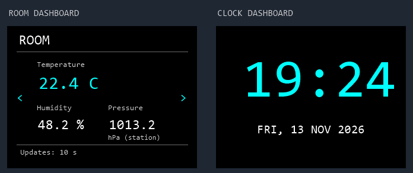

# ESP8266 touchscreen weather station

A desktop weather station with indoor temperature, humidity and pressure, trends, an hourly forecast, and a full-screen clock. Use the touchscreen to switch dashboards and the local web interface to configure the station.

## Parts

- LoLin NodeMCU V3 (ESP8266, 4 MB flash, CH340 USB serial).
- TJCTM24028-SPI 2.8-inch, 240 × 320 ILI9341 SPI TFT **with resistive touch**. Look for the separate `T_*` pins when ordering.
- BME280 I²C breakout. The reference sensor uses address `0x76`. A BMP280 measures temperature and pressure only.
- Female-to-female Dupont jumper wires and a micro-USB data cable.

## Wiring

Unplug USB before wiring. `3V` is 3.3 V and `G` is ground. Use the pin labels printed on the NodeMCU.

| Module | Module pin | NodeMCU |
| --- | --- | --- |
| BME280 | VIN, GND | 3V, G respectively |
| BME280 | SCL | D1 / GPIO5 |
| BME280 | SDA | D2 / GPIO4 |
| TFT | VCC, LED | 3V |
| TFT | GND, CS | G |
| TFT | RESET | RST |
| TFT | D/C | D3 / GPIO0 |
| TFT | SDI / MOSI | D7 / GPIO13 |
| TFT | SCK | D5 / GPIO14 |
| TFT | SDO / MISO | Leave disconnected |
| Touch | T_CLK | D8 / GPIO15 |
| Touch | T_DIN | D4 / GPIO2 |
| Touch | T_DO | D6 / GPIO12 |
| Touch | T_CS | D0 / GPIO16 |
| Touch | T_IRQ | Leave disconnected |

Touch has its own software SPI connections. Leave the SD-card pins disconnected. With TFT CS grounded, the display is always selected and the SD slot cannot share its SPI bus as wired here.

## First boot

1. Download `weather-6.bin` from [Firmware v6](https://github.com/unicastbg/weather-station-ota/releases/tag/v6). Connect the NodeMCU using USB and flash at address `0x0`, replacing `COMx` with your serial port. [Espressif esptool instructions](https://docs.espressif.com/projects/esptool/en/latest/esp8266/esptool/basic-commands.html#write-binary-data-to-flash-write-flash)

   ```sh
   esptool --chip esp8266 --port COMx write-flash 0x0 weather-6.bin
   ```

2. Restart and follow the four touchscreen calibration targets. Press and hold each target, then lift your finger.
3. On the touchscreen, open **Settings → Wi-Fi setup** to see the station's network name and password. Join that network and open [the setup page](http://192.168.4.1/) to select your 2.4 GHz home Wi-Fi and forecast location.
4. Once connected, use the home IP shown on the Wi-Fi setup panel or in the serial log at 115200 baud. The web interface lets you configure the startup dashboard, carousel, time zone and night schedule.

Check for firmware updates in the web settings. When the station finds a verified update, the bell on the Room dashboard opens the release highlights and touchscreen installer.

## Touchscreen previews

Illustrations of the Room and Clock dashboards using sample readings. Tap Clock to reveal its navigation arrows.


